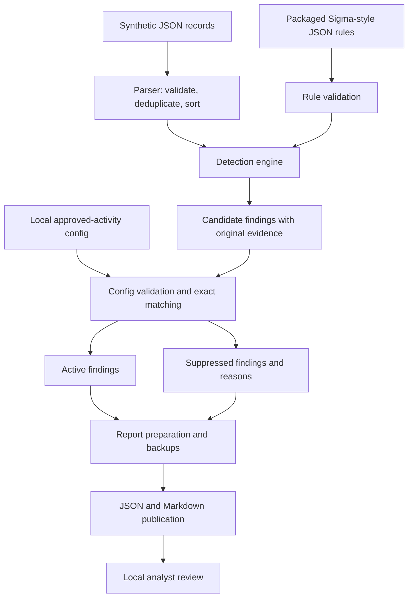

# Architecture

This Python application processes synthetic Amazon Web Services (AWS) CloudTrail-style events in one local process. A batch is one file or the JSON files immediately inside a folder.

## Files and interfaces

| Module | Responsibility |
| --- | --- |
| `models.py` | Dataclasses with named fields for events, findings, and technique mappings. |
| `parser.py` | Read JSON with duplicate-key and invalid-number rejection. Validate core event fields, normalize time, collapse identical event identifiers, reject conflicting copies, and sort by time and identifier. `read_json` also serves rule and config files. |
| `rules.py` | Validate and load the supported Sigma-style subset. Reject duplicate identifiers and unknown fields or conditions. Packaged rules travel with the installed Python package. |
| `detector.py` | Apply selections and named condition evaluators. Sort events and findings deterministically. Correlation uses a per-identity queue inside the configured time window. |
| `tuning.py` | Validate exact approvals. Classify matching findings as suppressed while retaining evidence and an approval reason. |
| `reporting.py` | Serialize active and suppressed findings. Escape report text for Markdown, retain original evidence as JSON, prepare both outputs, back up prior files, and recover from ordinary publication failures. |
| `cli.py` | Parse command-line arguments, coordinate the modules, print the summary, and return a clear exit status. |

## Input contract and evidence

A record requires nonempty strings for `eventID`, `eventTime`, `eventSource`, `eventName`, and `sourceIPAddress`. `eventTime` must parse as a date and time with a time-zone offset and is normalized to Coordinated Universal Time (UTC). `userIdentity` must supply a nonempty Amazon Resource Name (ARN), principal identifier, or username, used in that order.

Request and response fields may be JSON objects, null, or absent. An optional `errorCode` is a nonempty string, null, or absent. Missing rule-specific optional fields cause that condition to remain unmatched. These core checks support the synthetic lab format and leave full CloudTrail schema validation outside the implementation.

Normalization creates separate fields. The original event object stays in `raw` and is included under each finding's `evidence`. A record's original timestamp string stays intact there. Identical copies with the same event identifier collapse. A conflicting copy stops analysis before report writing. JSON files use strict duplicate-key handling at every object level. An embedded policy supplied as a JSON string is interpreted by the narrower policy helper described in the limitations.

## Rule and report contracts

Rule selection fields use exact equality. A list means any listed value, and multiple selector fields must all match. Named conditions provide additional behavior such as wildcard-policy checks or per-identity correlation.

Original report fields remain available under schema version `1`. `findings` and `finding_count` describe active findings. `suppressed_findings` contains the same finding fields plus `suppression_reason`. `suppressed_count` and `analysis_context` document tuning and effective baseline choices. Original evidence and interpretations are separate in both formats.

Each finding is ordered by normalized timestamp, final contributing event identifier, then rule identifier. There is no run timestamp or generated random identifier in report content. The same event set, configuration, and rule set produces identical report bytes.

## Publication and recovery

Use a separate output folder for every retained run and one writer per folder. Both report texts and backups are prepared inside a temporary directory on the output filesystem before destination replacement. A recoverable second-file replacement error restores the first file to its previous bytes, or removes it if it was newly created. Preparation failure leaves earlier reports intact.

Each replacement is atomic, meaning the filesystem exposes one complete file at that replacement point. The two-file pair has rollback on ordinary errors. Power loss, simultaneous writers, and failure during rollback can still leave an inconsistent pair. The command reports rollback failures explicitly. Report destinations that are symbolic links are rejected.

## Extension boundary

An eventual approved collector could supply exported records to `load_events` after addressing real-schema variations, integrity, retention, and sensitive-data requirements. The current implementation's supported workflow ends with local analyst investigation.
